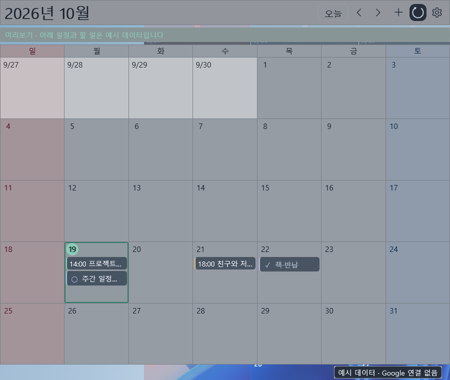

# DGCalendar

DGCalendar is a Windows desktop calendar for viewing and managing Google Calendar events and Google Tasks. You can also use local events and tasks without signing in.

[한국어](README.md) · [Website](https://dgcalendar.remerer.chatgpt.site/en/) · [Latest release](https://github.com/remerer/DGCalendar-releases/releases/latest) · [Feedback](https://github.com/remerer/DGCalendar-releases/issues/new/choose)

The screenshot shows the app with sample data and the Korean interface. You can adjust the theme, background opacity, weekday colors and text size.

## What's new in v0.1.5

- Multi-day events appear as weekly bars. A `›` at the end of Saturday and a `‹` at the start of Sunday show when the same event continues into the next week.
- Single-day and multi-day event backgrounds now use the same opacity.
- The monthly view uses a more compact layout for events, tasks and quick entry.
- Leaving a quick title edit blank keeps the existing title.
- An empty quick-entry field no longer blocks quitting the app.

## Features

- View, add, edit and delete events and tasks in the monthly calendar, and mark tasks complete.
- Connect Google Calendar and Google Tasks and choose which calendars to show.
- Use local events and tasks offline without a Google account.
- Double-click an empty part of a date to add an item quickly. You can change this action in Settings.
- Choose a Light, Dark or System theme and adjust opacity, weekday colors and text size.
- Move, resize or lock the calendar, use it across monitors and start it with Windows.
- Show anniversaries from selected calendars and highlight holidays.

The app uses Korean when the Windows display language is Korean and English otherwise.

## Download and run

DGCalendar runs on **Windows 10 version 1809 or later and Windows 11, x64**.

| Edition | Download | When to choose it |
|---|---|---|
| **Standard (recommended)** | [DGCalendar v0.1.5](https://github.com/remerer/DGCalendar-releases/releases/download/v0.1.5/DGCalendar-0.1.5-win-x64.zip) | This edition may require the Microsoft Visual C++ x64 Redistributable. |
| Static CRT | [DGCalendar v0.1.5 · Static CRT](https://github.com/remerer/DGCalendar-releases/releases/download/v0.1.5/DGCalendar-0.1.5-win-x64-static-crt.zip) | Choose this edition if you cannot install the extra runtime component. The app features are the same. |

1. Download and extract the entire ZIP.
2. Open `DGCalendar.exe` in the extracted `DGCalendar` folder. Keep the files together.
3. To sync with Google, open **Settings → Account → Connect Google**, sign in and grant the Calendar and Tasks permissions. Then choose the calendars to display.

Google sync uses the app's approved Desktop OAuth client. You can connect with your own Google account without creating API credentials. If the standard edition requires the Visual C++ runtime, install the **X64** package from Microsoft. [Microsoft download instructions](https://learn.microsoft.com/en-us/cpp/windows/latest-supported-vc-redist)

## Using the calendar

| To | Do this |
|---|---|
| Add an event or task | Use `+` or double-click an empty part of a date. |
| View, edit or delete an item | Open its details and use the pencil or trash button. Item click actions are configurable. |
| Mark a task complete or reopen it | Select the check area to the left of the task. |
| Move or resize the calendar | Unlock it and drag the top bar or border. |
| Change settings | Use the calendar's settings button or the notification-area icon menu. |

## Updates

Open **Settings → About** to check for a new release or enable update notifications. To switch versions, quit DGCalendar from its notification-area menu, extract the new ZIP to a fresh folder and run it there. Your existing events and settings are retained. If you use Start with Windows, turn it on again from the new folder.

## Support

- Report a bug or suggest an improvement in Korean or English. [Feedback forms](https://github.com/remerer/DGCalendar-releases/issues/new/choose)
- Open the support page through the coffee icon under **Settings → About**. [Buy Me a Coffee](https://buymeacoffee.com/remerer)
- [Privacy Policy](https://dgcalendar.remerer.chatgpt.site/en/privacy.html)

Technical and distribution details

- DGCalendar stands for Desktop with Google Calendar. This repository hosts Windows releases and user documentation.
- Both ZIPs include the .NET and Windows App SDK runtimes. The standard edition uses the dynamic CRT. The alternative links the CRT statically into the Rust core.
- Events, tasks and settings are stored in `%LOCALAPPDATA%\CalendarDesktop`. Google tokens and event data are protected for the Windows user.
- The application EXE and Rust DLL are unsigned. Windows may display an unknown-publisher warning.

DGCalendar is an independent app and is unaffiliated with Google and Microsoft.
