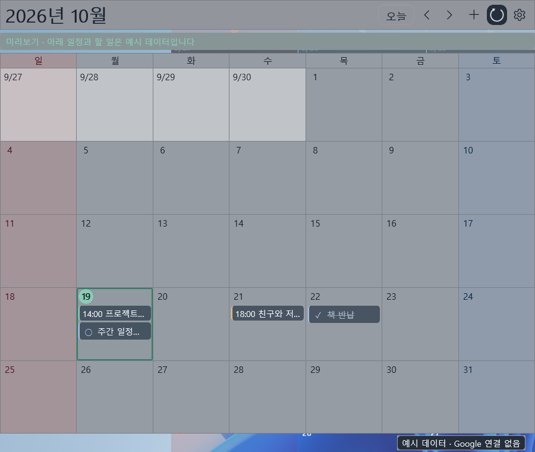

# DGCalendar

Desktop with Google Calendar. 일정과 할 일을 날짜별로 보여주는 Windows 바탕화면 달력입니다.

예시 일정과 할 일을 넣어 촬영한 실제 앱 화면입니다. 배경 밝기·투명도·요일 색·글자 크기는 취향에 맞게 조절할 수 있습니다.

## 다운로드

**기본 버전을 권장합니다.** 두 버전의 기능은 같습니다.

| 선택 | 다운로드 | 실행 안내 |
|---|---|---|
| **권장 · 기본 버전** | [DGCalendar 0.1.2 · Windows x64](https://github.com/remerer/DGCalendar-releases/releases/download/v0.1.2/DGCalendar-0.1.2-win-x64.zip) | 안정적인 실행에 필요한 Microsoft 공용 구성요소를 사용합니다. PC에 따라 추가 설치가 필요할 수 있습니다. |
| 추가 설치를 줄인 버전 | [DGCalendar 0.1.2 · 추가 구성요소 포함](https://github.com/remerer/DGCalendar-releases/releases/download/v0.1.2/DGCalendar-0.1.2-win-x64-static-crt.zip) | 필요한 구성요소를 더 포함했습니다. 기본 버전의 구성요소를 설치하기 어려운 경우 선택하세요. |

**Windows 10 1809 이상 또는 Windows 11의 x64 PC**에서 사용할 수 있습니다.

1. 원하는 버전의 ZIP을 다운로드합니다.
2. ZIP을 **전체 압축 해제**합니다.
3. `DGCalendar` 폴더 안의 `DGCalendar.exe`를 실행합니다. 별도의 앱 설치 과정은 없습니다.

기본 버전에서 Microsoft 구성요소 설치를 요구하면 [Microsoft 공식 다운로드 안내](https://learn.microsoft.com/en-us/cpp/windows/latest-supported-vc-redist)에 따라 **X64** 패키지를 설치해 주세요. 실행 파일만 따로 옮기거나 두 버전의 파일을 섞지 마세요.

## 주요 기능

- 바탕화면 월간 달력에서 일정·할 일 등록, 편집, 삭제, 완료 처리
- Google 연결 없이 사용하는 로컬 일정과 할 일
- 선택한 Google Calendar와 Google Tasks 연동
- 날짜의 빈 공간을 더블클릭해 빠르게 입력
- 투명도·배경 밝기·요일 색·글자 크기와 굵기 조절
- 위치·크기 잠금, 여러 모니터 지원, Windows 시작 시 실행
- 선택한 캘린더의 기념일 이름과 공휴일 강조 표시

## Google 계정 연결

Google 연동은 공개 모드로 전환했으며, Google의 앱 검증은 아직 완료되지 않았습니다. 로그인 시 미검증 앱 안내와 사용자 수 제한이 적용될 수 있습니다. 로컬 기능은 계정 연결 없이 사용할 수 있습니다.

앱의 설정에서 **Google 연결**을 누르고, 열리는 브라우저에서 로그인한 뒤 Calendar·Tasks 접근 권한을 허용하세요. 사용자가 별도로 Google API나 로그인용 앱 설정을 만들 필요는 없습니다. 이미 연결해 사용 중인 PC의 연결 정보는 업데이트 후에도 유지됩니다.

## 업데이트

설정 → **앱 정보**에서 현재 버전, **업데이트 확인**, GitHub 배포 페이지와 새 버전 알림 설정을 확인할 수 있습니다. 후원 링크는 같은 화면의 커피 아이콘으로 제공합니다.

앱은 새 버전을 알리며 자동 설치하지 않습니다. 업데이트할 때는 앱을 트레이 메뉴에서 종료한 뒤 새 ZIP을 **새 폴더**에 압축 해제해 실행하세요. 기존 일정과 설정은 유지됩니다. Windows 시작 시 실행을 사용 중이면 새 폴더에서 해당 옵션을 다시 켜 주세요.

[최신 릴리스와 변경 내용](https://github.com/remerer/DGCalendar-releases/releases/latest)을 확인할 수 있습니다. GitHub의 **Watch → Custom → Releases**를 켜면 GitHub에서도 새 버전 알림을 받을 수 있습니다.

## 피드백과 후원

문제 신고·개선 요청: [작성하기](https://github.com/remerer/DGCalendar-releases/issues/new/choose)

양식을 선택하면 입력칸마다 작성 예시를 볼 수 있습니다. [기존 제보](https://github.com/remerer/DGCalendar-releases/issues)도 확인할 수 있습니다.

개발 후원: [Buy Me a Coffee](https://buymeacoffee.com/remerer)

공개 이슈에는 계정 정보나 개인 일정, 로그인 설정 파일을 첨부하지 마세요.

개발 및 배포 정보

- 이 저장소는 Windows 배포 파일과 릴리스 안내를 제공합니다. 소스 코드는 포함하지 않습니다.
- 기본 버전은 동적 CRT 방식이며 Microsoft Visual C++ v14 x64 재배포 가능 패키지를 사용합니다.
- 추가 설치를 줄인 버전은 Rust 코어에 CRT를 정적으로 연결합니다. 모든 Windows 구성요소의 추가 설치가 불필요하다는 의미는 아닙니다.
- 두 버전 모두 .NET과 Windows App SDK 런타임을 포함합니다. 함께 제공되는 DLL과 화면 리소스도 필요합니다.
- 일정·할 일·설정은 `%LOCALAPPDATA%\CalendarDesktop`에 보관합니다. Google 토큰과 일정 데이터는 Windows 사용자에 묶여 암호화되므로 다른 PC나 Windows 계정으로 파일만 복사해 이전하는 방식은 지원하지 않습니다.
- 공개 ZIP에는 공용 Google Desktop OAuth 클라이언트 설정을 포함합니다. 사용자별 로그인 토큰과 개인 일정 데이터는 포함하지 않으며, 로그인 후 해당 PC에 저장합니다.
- 현재 배포에는 코드 서명이 없어 Windows에서 게시자를 확인하지 못할 수 있습니다.

DGCalendar는 독립 앱이며 Google 또는 Microsoft의 공식 제품이 아닙니다.
